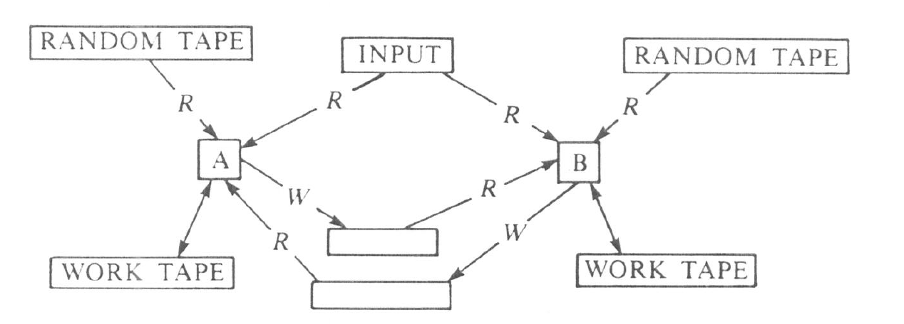

# 交互式证明系统的知识复杂度

The Knowledge Complexity of Interactive Proof Systems

Shafi Goldwasser、Silvio Micali、Charles Rackoff

《SIAM Journal on Computing》，第 18 卷第 1 期，1989 年 2 月，第 186–208 页。© 1989 Society for Industrial and Applied Mathematics。

> 译本说明　本稿依据 1989 年期刊扫描本翻译，已由 AI 逐页复核。页码标记指原刊；跨页句在同一段内译完。“目前”“已知”等叙述沿用作者写作时的语境。以“译校注”标明的文字为译本补充。

###### 原刊 186

**摘要**　一个定理的证明通常包含比“定理为真”这一事实更多的知识。例如，要证明一个图是哈密顿图，只需展示其中的一条哈密顿回路。然而，展示这条回路所包含的知识，似乎多于“是／不是哈密顿图”这一个比特。

本文为证明中所含的“知识”建立了一套计算复杂性理论。我们把零知识证明定义为这样一种证明：除所讨论的命题正确以外，它不传递任何额外知识。我们给出二次剩余语言和二次非剩余语言的零知识证明系统。这是首次为当时尚无已知高效识别算法的语言给出零知识证明的实例。

**关键词**　密码学；零知识；交互式证明；二次剩余。

**AMS（MOS）学科分类号**　68Q15，94A60。

## 1　引言

人们通常认为，说语言 $L$ 属于 NP（即它能在非确定性多项式时间内被接受），等价于说 $L$ 有一个多项式时间“证明系统”。我们心目中的系统是这样的：给定输入 $x$，“证明者”构造字符串 $\alpha$；“验证者”随后在 $x$ 和 $\alpha$ 上进行计算，在关于 $x$ 的二进制表示长度的多项式时间内，检验 $x$ 是否确实属于 $L$。一个自然的问题是，多项式时间证明系统有没有更一般、也许也更自然的定义？本文提出一种这样的定义。

我们仍只允许验证者使用多项式时间，而允许证明者拥有任意计算能力。现在，我们还允许双方各自抛掷公平硬币。这给出了 NP 的一种概率版本，允许出现小概率错误。不过，要充分发挥这一想法的作用，我们似乎还必须允许证明者和验证者**交互**（即来回交谈），并对各自的抛币结果**保密**。我们称这样的系统为“交互式证明系统”。第 2 节给出正式定义，并说明一个语言具有交互式证明系统是什么意思。

如何运用这种交互能力，远非显而易见。具有非确定性多项式时间算法或概率多项式时间算法的语言，都有很少交互或完全无需交互的证明系统。因此，我们希望找到这样的语言：它似乎既没有非确定性多项式时间算法，也没有概率多项式时间算法，却具有交互式证明系统。本文没有给出这样的实例，但文献中现已有之。Goldreich、Micali 和 Wigderson [GMW] 运用本文初稿 [GMR] 中的想法，证明了“图不同构”语言具有交互式证明系统。

**原刊首页注**　* 编辑部于 1985 年 8 月 26 日收到本文，1988 年 4 月 18 日接受修订稿。原刊称本文的早期版本见 1986 年第 27 届 IEEE 计算机科学基础年度研讨会论文集，第 174–187 页。编者注：本文原定刊于 1988 年 2 月密码学专号（《SIAM J. Comput.》，17，1988）。† Goldwasser 和 Micali：美国马萨诸塞州剑桥市麻省理工学院计算机科学实验室，邮编 02139。两位作者的工作得到美国国家科学基金会项目 DCR-84-13577 和 DCR-85-09905 的资助。‡ Rackoff：加拿大多伦多大学计算机科学系，多伦多，安大略省 M5S 1A4。其工作得到加拿大自然科学与工程研究理事会项目 A3611 的资助。

###### 原刊 187

Babai 和 Szemerédi [BS] 独立于本文证明，一些矩阵群问题具有他们所称的“Arthur–Merlin”证明系统，这立即意味着它们具有交互式证明系统。实际上，Arthur–Merlin 证明系统是一种受限的交互式证明系统，证明者可以看到验证者的抛币结果。尽管如此，Goldwasser 和 Sipser [GS] 已证明，一个语言具有交互式证明系统，当且仅当它具有 Arthur–Merlin 证明系统。

我们的交互式证明系统概念，似乎恰好提供了研究一个新问题所需的推广。事实上，本文的主要目的就是用交互式证明系统考察一个自然的问题：在 $L$ 的交互式证明系统中，有多少知识传给了验证者？以 SAT 为例，它是由命题演算中可满足的公式组成的 NP 完全语言。在最直接的证明系统中，为证明 $F\in\mathrm{SAT}$，证明者交出公式 $F$ 的一个满足赋值 $I$，验证者在多项式时间内检验它。验证者从中获得的知识远多于 $F\in\mathrm{SAT}$ 这个事实：他还得到了一个满足赋值。在另一个极端，凡能在概率多项式时间内接受的语言，都有一种证明系统，其中证明者什么也不做，因而也不向验证者传递任何知识。

如果对每个 $x\in L$，除了 $x\in L$ 以外，证明者实质上没有告诉验证者任何东西，我们就说 $L$ 的交互式证明系统是**零知识的**。即使验证者选择偏离协议，试图在多项式时间内诱使证明者透露某些东西，这一性质也应当成立。第 3 节将正式定义零知识。这一定义是本文的一项重要贡献。

本文的主要技术贡献是第 5、6 节的证明：语言 QR 和 QNR（定义见下）都具有零知识交互式证明系统。这是首次为尚无已知概率多项式时间识别算法的语言给出零知识协议。要理解 QR 和 QNR，可以先读第 4 节简短的数论背景。这里先设整数 $x,y$ 满足 $0<y<x$、$\gcd(x,y)=1$。如果存在某个 $z$ 使 $y=z^2\bmod x$，就称 $y$ 是模 $x$ 的**二次剩余**；否则，称它是模 $x$ 的**二次非剩余**。定义

$$\mathrm{QR}=\{(x,y)\mid y\text{ 是模 }x\text{ 的二次剩余}\},$$

$$\mathrm{QNR}=\{(x,y)\mid y\text{ 是模 }x\text{ 的二次非剩余}\}.$$

（实际上，第 4 节将给 QNR 一个略有不同的定义。）QR 和 QNR 均属于 NP，因而都有初等的证明系统。例如，为证明一个输入属于 QNR，证明者只须把 $x$ 的因数分解发给验证者。不过，着眼于后面的零知识证明系统，我们来讨论一个更有意思的 QNR 证明系统。

**例 1**　用 $A$ 表示证明者，$B$ 表示验证者。输入为 $(x,y)$。令 $n=|x|$，其中 $|x|$ 是 $x$ 的二进制表示长度。下面略去若干细节，描述 QNR 的一个交互式证明系统。$B$ 先抛币取得随机比特 $b_1,b_2,\ldots,b_n$，再抛币取得字符串 $\alpha$，从中算出 $z_1,z_2,\ldots,z_n$；每个 $z_i$ 都是满足 $0<z<x$、$\gcd(x,z)=1$ 的随机数 $z$。然后 $B$ 如下计算 $w_1,\ldots,w_n$：若 $b_i=0$，则 $w_i=z_i^2\bmod x$；若 $b_i=1$，则 $w_i=(z_i^2y)\bmod x$。$B$ 将所有 $w_i$ 发给 $A$。对每个 $i$，$A$ 用某种方法算出 $w_i$ 是否为模 $x$ 的二次剩余，并把比特序列 $c_1,\ldots,c_n$ 发给 $B$，其中 $c_i=0$ 当且仅当 $w_i$ 是二次剩余。$B$ 检查每个 $i$ 是否都满足 $b_i=c_i$，若都满足就“相信” $(x,y)\in\mathrm{QNR}$。

###### 原刊 188

不难看出，若 $(x,y)\in\mathrm{QNR}$ 且双方遵循协议，$B$ 就会“相信”。另一方面，如果 $y$ 是模 $x$ 的二次剩余，那么每个 $w_i$ 也都是二次剩余，且其可能取值等可能。由于 $A$ 看不到序列 $\{b_i\}$，所有 $c_i=b_i$ 同时成立的概率（也就是 $B$ 被说服的概率）为 $2^{-n}$。所以这是 QNR 的交互式证明系统。现在来看 $A$ 可能透露多少知识。

如何定义零知识，是个值得玩味的问题。假设证明者试图向验证者证明 $y$ 是模 $x$ 的二次剩余。验证者当然不应能诱使证明者透露 $y$ 模 $x$ 的一个平方根、$x$ 的因数分解，或任何足以使他比原来快得多地算出这些东西的信息。实际上，无论验证者想计算**什么**，证明者都不应透露任何能让他算得比原来快得多的信息。要把这一直觉正式表述出来，似乎应当要求：验证者在协议中看到的东西（即使他作弊），仅凭 $(x,y)\in\mathrm{QNR}$ 这一事实，他自己就能算出来。当然，验证者在协议中所见实际服从一个概率分布。因此，零知识意味着：给定 $(x,y)\in\mathrm{QNR}$，即使没有证明者，也能在多项式时间内生成一个随机视图，其分布与验证者实际同证明者交互时的视图分布相同（或几乎相同）。第 3 节给出正式定义。这里先非正式地讨论上述 QNR 交互式证明系统是否为零知识。

> 译校注　上一段先以证明二次剩余为例，随后转回 QNR，两个名称的转换沿用原刊。

取 $(x,y)\in\mathrm{QNR}$，设 $A$ 遵守协议。$B$ 能获得额外知识吗？先假定 $B$ 也遵守协议。$B$ “看到”的 $[\{b_i\},\alpha,\{w_i\},\{c_i\}]$ 服从某个分布。无需证明者帮助，我们就能快速生成服从这一分布的随机字符串：随机选取 $\{b_i\}$ 和 $\alpha$，由它们算出 $\{w_i\}$，再对每个 $i$ 置 $c_i=b_i$。

如果 $B$ 作弊呢？$B$ 可以一开始就设 $w_1=42$，然后才按协议行事。考虑这样在 $[\{b_i\},\alpha,\{w_i\},\{c_i\}]$ 上诱导出的分布。要在没有证明者帮助的情况下从中随机取样，给定 $x$ 和一个二次非剩余 $y$，我们必须判定 42 是否为模 $x$ 的二次剩余。目前尚不知怎样在多项式时间内完成这项计算，因此这个证明系统可能并非零知识。

第 6 节给出了 QNR 的零知识证明系统。其中一部分想法来自 Luby、Micali 和 Rackoff 的秘密交换协议 [LMR]，在那里也有用处。这些想法也用在 Fischer、Micali、Rackoff 和 Witenberg 的不经意传输协议 [FMRW] 以及 Feige、Fiat 和 Shamir 的身份识别方案 [FFS] 中。它们还帮助 Goldreich、Micali 和 Wigderson [GMW] 证明“图同构”和“图不同构”这两个语言均有零知识交互式证明系统。

我们觉得零知识交互式证明系统本身就引人入胜；不过，提出它的主要动机和它的主要应用都在密码协议领域。例如在 [LMR] 的秘密交换协议中，两个人想交换秘密，同时又不透露任何额外知识。即使只是要定义这个概念，也必须使用类似于本文的想法。

更一般地，协议进行到某一时刻，$A$ 往往希望使 $B$ 相信某个事实。假定我们知道：如果这时有一位天使或一位 $B$ 信任的人，能如实告诉 $B$，$A$ 说的是不是真话，那么协议就是安全的。我们希望零知识具有这样的含义：在这个位置用一个合适的零知识交互式证明系统代替受信任的一方，整个协议依然安全。

###### 原刊 189

（当然，$A$ 必须掌握某些额外信息，才能高效地执行证明者这一方的程序。）在特定情形下，我们能证明这种替换行得通。但要陈述一般定理，首先得有一个讨论协议的一般框架。尽管如此，根据直觉和经验，作者以及在这些想法问世后研究过它们的许多人，相信这里提出的零知识定义具有所需要的性质。

自这些结果首次出现以来，最重要的进展是 Goldreich、Micali 和 Wigderson [GMW] 的证明：在一个常用的复杂性理论假设下，NP 中的每个语言都具有零知识交互式证明系统。这些适用于 NP 语言的证明系统，似乎几乎能应用于每一个协议问题。正如 [GMW2] 的有力结果所表明的，上述成果几乎肯定会大大简化未来分布式密码协议的设计。

## 2　交互式证明系统

直观地说，我们应该对高效的定理证明过程提出什么要求？

（1）真定理应当能够被“证明”。

（2）假定理应当无法被“证明”。

（3）传达“证明”的过程应当高效。也就是说，不论找出证明需要多少时间，都应能高效地验证其正确性。

用 NP 来形式化高效证明系统，刻画了传达证明的一种方式。本节将推广 NP 证明系统，以刻画更一般的传达方式。验证者是一台概率多项式时间机器（多项式的自变量是公共输入的长度），能与证明者交换消息（字符串）。

在向证明系统引入概率的同时，我们放宽了经典“证明”的概念。验证者有可能误信一个命题为真，但出错的概率非常小：对每个正常数 $k$，当输入长度 $n$ 充分大时，错误概率小于 $n^{-k}$。

以下正式定义这种新系统。

### 2.1　交互式图灵机与协议

**定义**　交互式图灵机（ITM）是一台配有只读输入带、工作带、随机带、一条只读通信带和一条只写通信带的图灵机。随机带含有无限的随机比特序列，只能从左向右扫描。说交互式机器“抛一次硬币”，指的是它读取自己随机带上的下一个比特。

**图 1　交互式协议。** 无字母标记的连线表示读写头，R 表示只读头，W 表示只写头。图中 INPUT 为公共输入，RANDOM TAPE 为随机带，WORK TAPE 为工作带。

###### 原刊 190

**定义**　一个交互式协议是一个由交互式图灵机 $A$、$B$ 组成的有序对。它们共用输入带，$B$ 的只写通信带是 $A$ 的只读通信带，反之亦然。$A$ 的计算能力不受限制；$B$ 的计算时间以公共输入长度的一个多项式为界。两台机器轮流处于活动状态，由 $B$ 先开始。在一个活动阶段，$A$（或 $B$）先利用输入带、工作带、通信带和随机带作内部计算，再把要发给 $B$（或 $A$）的字符串写入自己的只写通信带。$A$（或 $B$）的第 $i$ 条消息，就是它在第 $i$ 个活动阶段写到通信带上的整个字符串。一旦写完消息，这台机器就转入非活动状态，另一台开始活动，除非协议已经终止。任何一方都可以在自己的活动阶段不发消息，从而终止整个协议。$B$ 输出“接受”或“拒绝”并终止协议，表示它接受或拒绝输入。$B$ 的计算时间等于它所有活动阶段的计算时间之和；受输入长度 $|x|$ 的多项式所界定的，正是这个时间。

### 2.2　交互式证明系统

**定义**　设 $L$ 是 $\{0,1\}^{*}$ 上的语言，$(A,B)$ 是交互式协议。若满足以下条件，则称 $(A,B)$ 为 $L$ 的一个**交互式证明系统**。

（1）对每个 $k$，对 $L$ 中所有充分长的 $x$，将 $x$ 输入 $(A,B)$ 时，$B$ 以至少 $1-|x|^{-k}$ 的概率停机并接受。（概率取遍 $A$ 和 $B$ 的抛币结果。）

（2）对每个 $k$，对所有充分长且不属于 $L$ 的 $x$，对任意交互式图灵机 $A'$，将 $x$ 输入 $(A',B)$ 时，$B$ 接受的概率至多为 $|x|^{-k}$。（概率取遍 $A'$ 和 $B$ 的抛币结果。）

**说明 1**　用标准方法多次重复协议，以多数票决定是否接受，可以把上述错误概率降到例如 $2^{-|x|}$ 以下。

这一定义确实刻画了我们直观上对高效证明系统的要求。条件（1）说，如果 $x\in L$，$B$ 就以压倒性概率接受。条件（2）说，如果 $x\notin L$，则不存在能以不可忽略概率使 $B$ 接受的策略。事实上，$B$ 无须信任与它交互的机器，也无须知道对方的程序。$B$ 只须相信自己抛币的随机性。

与 NP 证明系统相似，这里强调的是语言的“是”实例：当字符串属于该语言时，必须使 $B$ 以高概率接受；当字符串不属于该语言时，并不要求 $A$ 使 $B$ 相信它不属于该语言。

还可以把定义推广，允许 $A$ 是一台无限状态机。Feldman [F] 证明，这样做并不增强模型的能力。事实上，他证明，就语言识别而言，取 $A$ 为确定性 PSPACE 机器已经足够。$A$ 可以使用随机性，对下一节中更精细的零知识定义则很重要。

我们把存在交互式证明系统的语言类记作 IP，即**交互式多项式时间**。Babai 和 Szemerédi [BS] 最先给出了属于 IP 而尚不知道是否属于 NP 的语言实例，即“矩阵群非成员判定”和“矩阵群阶”问题，其中有限域上的矩阵群用一组生成矩阵表示。另一个更为人熟知的实例是 Goldreich、Micali 和 Wigderson [GMW] 给出的“图不同构”。

###### 原刊 191

他们证明了，由彼此不同构的图对组成的语言属于 IP。

### 2.3　Arthur–Merlin 博弈

Babai 独立提出了“Arthur–Merlin 博弈”的概念。在这种交互式证明系统中，Merlin 扮演 $A$，Arthur 扮演 $B$。它允许的交互比我们的模型少，因为 Merlin 看得到 Arthur 的全部抛币结果。Arthur 发给 Merlin 的消息只能是一个随机选取的字符串。在交互式证明系统中，给定一个多项式时间可计算函数 $f$，验证者可以秘密选取随机串 $R$，只把 $f(R)$ 发给证明者（例如例 1 的 QNR 系统）。

由这一限制立即可知，Arthur–Merlin 博弈能识别的语言，是具有交互式证明系统的语言的子集。有趣的是，Goldwasser 和 Sipser [GS] 证明这个子集并非真子集。同时保留两种定义仍有价值：使用交互式证明系统的定义，协议设计比较容易；使用 Arthur–Merlin 的定义，证明复杂性结果比较容易。

秘密地作随机选择，虽无助于识别更多语言，我们却相信它对以零知识方式识别语言至关重要。第 3.7 节的猜想将给出这一信念的准确表述。

Blum [Bl] 的一篇论文已经隐含地使用了一种 Arthur–Merlin 型交互式证明系统。他给出了识别 Blum 整数语言的交互式协议：

$$\mathrm{BL}=\{n\mid p^\alpha\mid n,\ p^{\alpha+1}\nmid n,\ p\text{ 为素数},\ p\equiv3\bmod4,\ \alpha\text{ 为奇数}\}.$$

证明者的目标是使对方相信 $n\in\mathrm{BL}$，而无须发送 $n$ 的素因数分解。在这个系统中，验证者只发言一次，消息就是其抛币结果序列。Goldwasser 和 Micali [GM1] 也发现了这类协议，可在不披露素因数分解的情况下，证明输入属于下列语言：

$$\mathrm{GM1}=\{n\mid n\text{ 恰有两个不同的素因数}\},$$

$$\mathrm{GM2}=\{(x,n)\mid\gcd(x,\phi(n))=1\},$$

其中 $\phi(n)$ 是小于 $n$ 且与 $n$ 互素的正整数的个数。

## 3　零知识

我们给出的定义比仅适用于交互式证明系统的定义更一般。对任意交互式协议 $(A,B)$，不论它是不是语言 $L$ 的证明系统，我们都要定义它“对 $L$ 是零知识的”是什么意思。实际上，这一定义完全不依赖于 $B$。我们将看到，它要求对每个多项式时间的 $B'$，在输入 $x\in L$ 上与 $A$ 交互时，$B'$ 在自己所有带上“看到”的内容形成的分布，与某个能从 $x$ 在多项式时间内算出的分布“不可区分”。因此，先讨论随机变量的不可区分性。

### 3.1　随机变量的不可区分性

全文只考虑形如 $U=\{U(x)\}$ 的随机变量族，参数 $x$ 来自某个语言 $L\subset\{0,1\}^{*}$，所有随机变量均在 $\{0,1\}^{*}$ 中取值。设 $U=\{U(x)\}$ 和 $V=\{V(x)\}$ 是两个随机变量族。我们希望表达，当 $x$ 的长度增加时，$U(x)$ 实质上可以由 $V(x)$ “替代”。为此考虑如下框架。

从 $U(x)$ 或 $V(x)$ 中抽取随机样本，交给一位“裁判”。看过样本之后，裁判给出判决 0 或 1。（可将 0 解释为裁判判定样本来自 $U(x)$，1 解释为判定它来自 $V(x)$。）

###### 原刊 192

于是很自然地，如果随着 $x$ 变长，任何裁判的判决都会变得“没有意义”，即与样本实际来自哪个分布几乎无关，我们就说，对充分长的 $x$，$U(x)$ 可以由 $V(x)$ “替代”。

这个框架中有两个相关参数：样本量，以及给裁判作出判决的时间。对它们施加不同限制，就得到不同的不可区分性概念。我们关注三种最重要的情形：相等、统计不可区分、计算不可区分。粗略地说，如果 $\{U(x)\}$ 和 $\{V(x)\}$ 相等，那么即使裁判得到任意大的样本量，并且可以花任意长的时间研究，其判决也没有意义。如果裁判的计算时间不限，但只能取得多项式个随机样本（以 $|x|$ 为参数），而他的判决仍没有意义，就称两个族在统计上不可区分。如果样本量和计算时间都受 $|x|$ 的多项式限制，而判决仍没有意义，就称两个族在计算上不可区分。下面给出形式化定义。

**定义（统计不可区分性）**　设 $L\subset\{0,1\}^{*}$ 是一个语言。若对所有常数 $c>0$ 及所有充分长的 $x\in L$，都有

$$\sum_{\alpha\in\{0,1\}^{*}}\left|\Pr[U(x)=\alpha]-\Pr[V(x)=\alpha]\right|<|x|^{-c},$$

则称随机变量族 $\{U(x)\}$ 和 $\{V(x)\}$ 在 $L$ 上**统计不可区分**。

对上述 $U,V$，若样本个数受 $|x|$ 的某个多项式限制，即使裁判具有无限计算能力，也无法可靠地分辨样本来自 $U(x)$ 还是 $V(x)$。他的回答基本上没有用处，因为两种情况下他回答“1”的概率几乎相同。

**例 2**　设 $U(x)$ 给所有长度为 $|x|$ 的字符串相同的概率。$V(x)$ 对同样长度的字符串均赋予概率 $2^{-|x|}$，但有两个例外：给 $0^{|x|}$ 的概率为 0，给原刊记作 $1^{-|x|}$ 的字符串的概率为 $2^{-|x|+1}$。则 $\{U(x)\}$ 与 $\{V(x)\}$ 在 $\{0,1\}^{*}$ 上统计不可区分。

> 译校注　例 2 第二个例外所指的字符串在扫描本上印作 $1^{-|x|}$。按本段“长度为 $|x|$”的条件，应读作全 1 串 $1^{|x|}$。上段保留印本写法。

为形式化计算不可区分性，我们用到非一致性（理由见第 3.4 节）。这里用一个**多项式规模电路族**充当“裁判”，取代多项式时间图灵机。它是只有一个布尔输出的布尔电路族 $C=\{C_x\}$，存在常数 $e>0$，使每个 $C_x\in C$ 至多有 $|x|^e$ 个门。为了将概率分布中的样本输入这类电路，我们只考虑**多项式有界**的随机变量族，即 $U=\{U(x)\}$ 满足：存在常数 $d>0$，每个随机变量 $U(x)$ 仅对长度恰为 $|x|^d$ 的字符串赋予正概率。对这样的 $U$ 和多项式规模电路族 $C$，记 $P(U,C,x)$ 为按 $U(x)$ 分布随机取一个字符串输入 $C_x$ 后，电路输出 1 的概率。（这里假设 $U(x)$ 赋予正概率的字符串长度，恰等于 $C_x$ 的布尔输入数。）

**定义（计算不可区分性）**　设 $L\subset\{0,1\}^{*}$。若对所有多项式规模电路族 $C$、所有常数 $c>0$ 和所有充分长的 $x\in L$，都有

$$|P(U,C,x)-P(V,C,x)|<|x|^{-c},$$

则称两个多项式有界的随机变量族 $U,V$ 在 $L$ 上**计算不可区分**。

###### 原刊 193

Goldwasser 和 Micali [GM] 在加密的语境中、Yao [Y] 在伪随机生成的语境中，都已经使用过这一概念。显然，$U$ 和 $V$ 如完全相同，就统计不可区分。统计不可区分也蕴含计算不可区分。事实上，设 $C_x$ 为电路，$S$ 为使它输出 1 的输入集合。由于 $U$ 和 $V$ 统计不可区分，$U(x)$ 与 $V(x)$ 的值落在 $S$ 中的概率几乎完全相同，故 $P(U,C,x)$ 与 $P(V,C,x)$ 非常接近。

**例 3**　考虑一个在 Goldwasser 和 Micali [GM] 意义下安全的概率加密算法。对整数 $n$，令 $U(1^n)$ 和 $V(1^n)$ 分别表示安全参数为 $n$ 时，对 0 和 1 加密所得密文的随机变量。那么 $U$ 和 $V$ 在 $L=\{1\}^{*}$ 上计算不可区分。

我们认为，对随机变量而言，计算不可区分性达到了恰当的一般程度。下文把计算不可区分的两个随机变量族简称为**不可区分**。

**说明 2**　值得指出的是，上一定义对样本数量的选取并不敏感。定义中，计算能力受限的“裁判”只得到一个样本；这并不构成限制。两个随机变量族 $\{U_x\}$ 和 $\{V_x\}$ 在单样本意义下计算不可区分，当且仅当：给 $C_x$ 多项式个输入串（以 $|x|$ 为参数），这些串全部独立地按 $U_x$ 取样时的接受概率，与全部独立地按 $V_x$ 取样时的接受概率接近。

### 3.2　随机变量的可逼近性

现在形式化这样一个概念：随机变量 $U$ 在实质上容易生成。也就是说，有一个高效算法，能随机输出字符串，其分布与 $U$ 不可区分。

**定义**　设概率图灵机 $M$ 在输入 $x$ 上以概率 1 停机。记 $M(x)$ 为这样一个随机变量：对每个串 $\alpha$，它取值 $\alpha$ 的概率恰好是 $M$ 在输入 $x$ 上输出 $\alpha$ 的概率。

**定义**　设 $L\subset\{0,1\}^{*}$ 是一个语言，$U=\{U(x)\}$ 是一族随机变量。如果存在一台在期望多项式时间内运行的概率图灵机 $M$，使所有 $x\in L$ 都有 $M(x)$ 与 $U(x)$ 同分布，则称 $U$ 在 $L$ 上**完美可逼近**。如果存在这样一台期望多项式时间概率图灵机 $M$，使 $\{M(x)\}$ 与 $\{U(x)\}$ 在 $L$ 上统计（计算）不可区分，则称 $U$ 在 $L$ 上**统计（计算）可逼近**。

下文的“可逼近”指计算可逼近。现在可以定义零知识了。

### 3.3　零知识协议与零知识证明系统

我们首先处理“作弊验证者” $B'$ 的问题，即允许它偏离协议。

**定义**　设 $(A,B)$ 为交互式协议。令 $B'$ 为一台交互式图灵机，输入是 $x$，另在一条额外的输入带上给它 $H$，$H$ 的长度以 $|x|$ 的一个多项式为上界。（图 1 应给 $B'$ 加上这条带。）当 $B'$ 与 $A$ 交互时，$A$ 在输入带上只看到 $x$，而 $B'$ 看到 $(x,H)$。可以把 $H$ 想成作弊的 $B'$ 已经拥有的关于 $x$ 的某些知识。

###### 原刊 194

也可以把 $H$ 看作先前交互的历史，作弊的 $B'$ 正试图利用它从 $A$ 获得知识。下一小节将详述。假设 $B'$ 与 $A$ 交互时的总计算时间以 $|x|$ 的某个多项式为上界。

在公共输入 $x$、额外输入 $H$ 上运行一次协议，定义 $B'$ 的**视图**为它所看到的一切。具体地说，令 $\sigma$ 和 $\rho$ 分别是 $A$ 和 $B'$ 随机带上的字符串。对这些随机选择，设计算有 $n$ 轮，$B'$ 先发言，$a_i,b_i$ 分别是 $A,B'$ 的第 $i$ 条消息。称 $(\rho,b_1,a_1,\ldots,b_n,a_n)$ 为 $B'$ 在输入 $x,H$ 上的视图，并令 $\mathrm{View}_{A,B'}(x,H)$ 为取值为该视图的随机变量。（把 $B'$ 写在私有带上的内容计入视图，或删去 $B'$ 发给 $A$ 的字符串，都没有影响；这些比特可以从视图的其余比特高效地算出。）为方便起见，把每个视图看作 $\{0,1\}^{*}$ 中长度恰为 $|x|^c$ 的字符串，其中 $c>0$ 为某个固定常数。

**定义**　设 $L\subset\{0,1\}^{*}$，$(A,B)$ 为协议，$B'$ 如上。如果随机变量族 $\mathrm{View}_{A,B'}$ 在

$$L'=\{(x,H)\mid x\in L,\ |H|=|x|^c\}$$

上完美（统计、计算）可逼近，就称 $(A,B)$ **对于 $B'$ 在 $L$ 上是完美（统计、计算）零知识的**。如果该性质对每一台概率多项式时间交互式图灵机 $B'$ 成立，就称 $(A,B)$ **在 $L$ 上是完美（统计、计算）零知识的**。

> 译校注　这里量词的先后是：对每一台验证者 $B'$，都应当存在一台适用于它的模拟器 $M$。在相同的公共输入 $x$ 和辅助输入 $H$ 下，比较模拟器的输出与真实视图。完美零知识要求二者同分布。

注意，$(A,B)$ 对 $B'$ 是否以某种意义为零知识，仅取决于 $A$，完全不取决于 $B$。把它理解成“$A$ 对 $B'$ 是零知识的”也许更不容易误解。第 2.2 节的定义也有类似现象：其中条件（2）只依赖于 $B$，完全不依赖于 $A$。

计算零知识显然是上述概念中最一般的，下文简称为**零知识**。零知识所要刻画的是，关于 $L$ 的成员，有哪些信息原来无法在多项式时间内高效获得。也就是说，如果 $(A,B)$ 为零知识，就无法在概率多项式时间内靠与 $A$ 交互提取任何这类信息，即使“作弊”也不行。

**定义**　设 $L\subset\{0,1\}^{*}$。如果 $(A,B)$ 既是 $L$ 的交互式证明系统，又是在 $L$ 上完美（统计、计算）零知识的协议，就称它为 $L$ 的**完美（统计、计算）零知识证明系统**。

下文把计算零知识证明系统（三者中最一般者）简称为**零知识证明系统**。这一概念完全足以应付现实情形。也就是说，如果 $(A,B)$ 是 $L$ 的零知识证明系统，则在多项式时间内，任何一方（即使是“作弊”的 $B'$）与 $A$ 交互，也无法提取出 $L$ 成员资格的证明之外的任何东西。

### 3.4　关于上述定义的几点说明

首先，在对 $B$ 的零知识定义中，$B$ 的抛币结果是视图不可缺少的一部分。考虑由所有合数组成的语言 $L$ 和下面的协议 $(A,B)$。

###### 原刊 195

输入整数 $n$，$B$ 在 1 与 $n$ 之间随机选择与 $n$ 互素的整数 $x$，将 $a=x^2\bmod n$ 发给 $A$。$A$ 随机选取 $a$ 模 $n$ 的一个平方根 $y$ 回送。如果视图只包含双方交换的消息文本，上述协议在 $L$ 上就会是完美零知识的。不过，我们定义的视图也包含 $B$ 的抛币结果。因此，若从 $\mathrm{View}_{(A,B)}(n)$ 中随机抽取 $(x,a,y)$，则 $\gcd(x+y,n)$ 既不是 1 也不是 $n$ 的概率至少为 $1/2$。所以，如果因数分解不属于概率多项式时间，上述协议对 $B$ 并非零知识。（不过，在要求对**一切** $B'$ 成立的零知识定义中，不必把 $B'$ 的随机比特计入视图。因为我们已经计入了 $B'$ 发出的消息，并且对每一个 $B'$，都存在一个其余行为相同、但在最后一条消息里附上自身随机比特的 $B''$。）

> 译校注　原刊对合数给出“至少 $1/2$”的表述，需留意模数的范围。例如 $n=9$ 时，任一可逆平方的两个平方根互为相反数，对文中的 $x,y$，$\gcd(x+y,9)$ 只能是 1 或 9。以 $n=15$、$x=1$ 为例，1 的四个平方根是 1、4、11、14，其中两个给出非平凡因数，概率恰为 $1/2$。

其次，应解释为何让 $B'$ 看到额外的字符串 $H$。（本文作者、Oren [O]、Tompa 和 Woll [TW] 各自独立地发现了这一需要。）$H$ 有几种理解方式。它可能是验证者（不论其是否作弊）碰巧知道的额外信息。例如，即使验证者碰巧知道两个图的着色方案，图同构的零知识协议也应当保持零知识。该协议也可能被嵌入另一协议的中段，此时验证者已经看过一段历史 $H$。令人担心的是，这段历史可能产生于与一台能力无限的机器的交互。我们希望排除验证者在与 $A$ 交互时利用 $H$ 获得知识的可能。允许计算不可区分性定义中的区分电路具有非一致性，道理类似。我们希望，只要存在能区分两个随机变量族的电路，就能称这两个族计算可区分；这类电路可能预先硬编码了关于 $x$ 的某些信息，也可能预置了相关协议所在的外层协议的历史信息。换言之，$B'$ 在输入 $(x,H)$ 上获得的视图，应当看起来像模拟得到的分布 $M(x,H)$。

检验定义的一种方式，是看我们能否证明那些直觉告诉我们必然为真的事实。一个这样的事实是，把一个零知识协议重复多项式次，仍然是零知识的。利用当前的定义可以证明这一点；但例如，若不给 $B'$ 额外输入 $H$，便无法用这样的定义证明这一点。我们还能证明：如果 $B'$ 想判定 $x\in L$ 上的某个特定谓词 $P(x)$，参加 $L$ 的零知识证明系统并不能给它帮助。我们想证明的直观上显然的“事实”，用这套定义都能证明。然而，这些定义是否合适、还需不需要修改，只有时间能够检验。我们觉得（也希望）它们恰好刻画了我们想表达的直觉。

> 译校注　此段说的重复，是先完成一次协议，再把已有的交互历史作为辅助输入继续下一次。文中这段论证针对顺序重复。

最后，一个特别之处是，允许模拟视图的机器 $M$ 在**期望**多项式时间内运行。这对第 6 节给出的 QNR 零知识证明系统似乎是必要的。为了看清一般情形中的缘由，考虑 $(A,B)$：$B$ 在长度为 $n$ 的输入上发送 $n$ 个随机比特 $\alpha$ 给 $A$；若谓词 $P(\alpha)$ 成立，$A$ 就发送一个随机选取的、使 $P(\beta)$ 成立的 $n$ 比特串 $\beta$。设 $P$ 很容易计算，但满足 $P$ 的 $n$ 比特串很少，比例可能是 $n^{-10}$，也可能是 $n^{-20}$，我们不知道究竟是多少；又设已知找出这种串的唯一办法是不断选随机串，直到找到一个满足 $P$ 的为止。要使模拟出的 $B$ 的视图在统计上接近真实视图（甚至只要求计算不可区分），我们所知的唯一方法，是先选随机 $\alpha$；若 $P(\alpha)$ 成立，再搜寻随机 $n$ 比特串，直到找到满足 $P(\beta)$ 的 $\beta$。这一过程只有在期望意义下才是多项式时间。

###### 原刊 196

### 3.5　具有零知识证明的语言实例

显然，BPP 中的所有语言都有完美零知识证明系统。（若有一台概率多项式时间机器，对每个输入都能以很小的出错概率判定它是否属于该语言，就称该语言属于 BPP。）

最早的非平凡零知识证明系统（即识别尚不知道是否属于 BPP 的语言的系统），是第 5 节给出的二次剩余语言 QR 的完美零知识证明系统，以及第 6 节给出的 QNR 的统计零知识证明系统。

最近，Goldreich、Micali 和 Wigderson [GMW] 证明，图同构语言有完美零知识证明系统，图不同构语言（虽尚不知道是否属于 NP）有统计零知识证明系统，而且如果存在安全的加密方案，NP 中的所有语言都有计算零知识证明系统。文献 [BGGHKMR] 证明，IP 中的所有语言都有零知识证明系统。

> 译校注　原刊在最后一句省略了假设。所引 Ben-Or 等人的论文在摘要中明确假定安全的概率加密方案存在；在此假设下得到的是计算零知识。该文的另一项完美零知识结果另有承诺机制假设。

Boppana、Håstad 和 Zachos [BHZ] 以及 Fortnow [Fo] 的结果表明，若某个 NP 完全语言具有完美或统计零知识证明系统，多项式时间层级就会坍缩。因此，[GMW] 给出的图着色交互式证明系统仅在计算意义下为零知识，也许并不令人意外。更直接的原因是它们用到了概率加密 [GM]（见例 3）。这也许会使人把 Fortnow 的结果解读为：在 NP 完全语言的任何零知识证明系统中，加密都至关重要。（关于 Fortnow 的结果，另见第 7 节。）

### 3.6　重审早先的方案

有了零知识证明系统的概念，现在回头看看第 2.3 节提到的 Blum [Bl] 以及 Goldwasser 和 Micali [GM1] 早期的 Arthur–Merlin 型证明系统。

**BL 的证明系统（BL 定义见第 2.3 节）。** 在那篇精彩的论文中，Blum 在整数因数分解计算困难的假设下，提出了通过电话抛硬币的协议。为“公平地”抛硬币，Alice 和 Bob 需要一个整数 $n$：Alice 知道它的素因数分解，Bob 不知道，而且 $n$ 必须具有特殊性质，即 $n\in\mathrm{BL}$。Alice 用两个随机选取的、模 4 都与 3 同余的素数相乘得到 $n$，又相信因数分解很难，因此她确信抛币是公平的。等正反面结果出来后，Bob 向 Alice 索取 $n$ 的因数分解来检验公平性。因此，每次抛币都应该选用不同的 $n$。为提高效率，Blum 提议用一种不会以明显方式泄露 $n$ 的因数分解的协议来检验 $n\in\mathrm{BL}$。稍作修改，即可证明 Blum 的协议在 BL 上是完美零知识的。没有这一修改，协议会泄露多少关于 $n$ 的因数分解的信息，并不清楚。

**GM1 和 GM2 的证明系统（定义见第 2.3 节）。** Goldwasser 和 Micali 的密码协议采用 Blum 抛币协议的低效率版本，因此假设整数因数分解在计算上困难。在此假设下，他们证明自己的证明系统不会泄露输入 $n$ 的素因数分解。也就是说，任何作弊的多项式时间验证者在参加协议以后，都无法以比原先快得多的速度分解 $n$。

###### 原刊 197

更一般地，实际上可以证明，这两个协议分别在 GM1 和 GM2 上是计算零知识的。特别地，它们甚至不会泄露例如 3 是否为模 $n$ 的二次剩余。

### 3.7　零知识情形下的交互式证明系统与 Arthur–Merlin 博弈

现在可以正式表述我们的看法：以零知识方式识别语言，交互式证明系统比 Arthur–Merlin 博弈更合适。

**猜想**　存在语言 $L$，它有完美或统计零知识证明系统，却没有任何在 $L$ 上“完美或零知识”的 Arthur–Merlin 证明系统。

> 译校注　引号内照录本页末半句的措辞 “perfect or zero-knowledge”。它与前半句 “perfect or statistical zero-knowledge” 不对称，原刊未说明原因。

## 4　二次剩余性问题

本节介绍第 5、6 节证明所需的数论背景与记号。

记 $\mathbb N$ 为自然数集，$x\in\mathbb N$，$\mathbb Z_x^{*}=\{y\mid1\le y<x,\ \gcd(x,y)=1\}$。可在关于 $|x|$、$|y|$ 为多项式的时间内判定 $y$ 是否属于 $\mathbb Z_x^{*}$。

若存在 $w\in\mathbb Z_x^{*}$ 使 $w^2\equiv y\bmod x$，则称 $y\in\mathbb Z_x^{*}$ 为模 $x$ 的**二次剩余**。否则，称它为模 $x$ 的**二次非剩余**。

**事实 1**　设 $x\in\mathbb N$、$y\in\mathbb Z_x^{*}$。$y$ 为模 $x$ 的二次剩余，当且仅当它以 $x$ 的每个素因数为模时都是二次剩余。

> 译校注　原刊在此将 $x$ 写作任意自然数。对偶数模数，所述等价一般不成立。例如 3 模 2 是二次剩余，模 8 却不是。下文使用雅可比符号时也应留意奇模数这一条件。

定义二次剩余性谓词

$$Q_x(y)=\begin{cases}0&\text{若 }y\text{ 是模 }x\text{ 的二次剩余},\\1&\text{否则}.\end{cases}$$

由此有如下事实。

**事实 2**　设 $x\in\mathbb N$ 且 $y\in\mathbb Z_x^{*}$。给定 $y$ 和 $x$ 的素因数分解，可以在关于 $|x|$ 为多项式的时间内计算 $Q_x(y)$。

设 $y\in\mathbb Z_x^{*}$，且 $x$ 的素因数分解为 $\prod_{i=1}^{k}p_i^{\alpha_i}$。$y$ 模 $x$ 的**雅可比符号**定义为

$$(y/x)=\prod_{i=1}^{k}(y/p_i)^{\alpha_i},$$

其中，若 $y$ 为模 $p_i$ 的二次剩余，则 $(y/p_i)=1$；否则为 $-1$。

**事实 3**　给定 $x\in\mathbb N$、$y\in\mathbb Z_x^{*}$，可以在关于 $|x|$ 为多项式的时间内计算 $(y/x)$。

雅可比符号能提供关于 $y$ 是否为模 $x$ 的二次剩余的部分信息。若 $(y/x)=-1$，则 $y$ 为二次非剩余，$Q_x(y)=1$。但在 $(y/x)=1$ 时，还没有已知的高效算法（概率或确定性多项式时间），能以明显优于 $1/2$ 的概率正确计算 $Q_x(y)$。由此得到二次剩余性问题。

**定义**　二次剩余性问题是：输入 $x,y$，在 $y\in\mathbb Z_x^{*}$ 且 $(y/x)=1$ 的条件下，计算 $Q_x(y)$。

目前计算 $Q_x(y)$ 的最佳算法是先分解 $x$，再计算 $Q_x(y)$。事实上，有人猜想整数因数分解与计算 $Q_x$ 具有相同的时间复杂度。二次剩余性问题的困难性已经成为若干密码协议的设计基础 [GM]、[LMR]、[Bl]。

定义下面两个语言，其中 $x,y$ 均以二进制表示：

$$\mathrm{QR}=\{(x,y)\mid x\in\mathbb N,\ y\in\mathbb Z_x^{*},\ Q_x(y)=0\},$$

$$\mathrm{QNR}=\{(x,y)\mid x\in\mathbb N,\ y\in\mathbb Z_x^{*},\ (y/x)=1,\ Q_x(y)=1\}.$$

###### 原刊 198

由事实 1 和 2 可见，QR 和 QNR 都属于 co-NP 与 NP 的交集。然而，尚无已知的概率多项式时间算法接受这两个语言，因此对于它们，零知识性质并非平凡可得。第 5 节给出 QR 的完美零知识证明系统，第 6 节给出 QNR 的统计零知识证明系统。以下事实在两节的零知识证明中会用到。

**事实 4**　设 $x\in\mathbb N$。对所有使 $Q_x(y)=0$ 的 $y$，同余式 $w^2\equiv y\bmod x$ 在 $\mathbb Z_x^{*}$ 中的解数相等，与 $y$ 无关。

**事实 5**　设 $x\in\mathbb N$ 且 $y,z\in\mathbb Z_x^{*}$。有（a）如果 $Q_x(y)=Q_x(z)=0$，则 $Q_x(yz)=0$；（b）如果 $Q_x(y)\ne Q_x(z)$，则 $Q_x(yz)=1$。

**事实 6**　给定 $x,y$，用欧几里得算法求最大公因数，可以在多项式时间内判定 $y$ 是否属于 $\mathbb Z_x^{*}$。

## 5　二次剩余性的零知识证明

回忆 $\mathrm{QR}=\{(x,y)\mid y\text{ 是模 }x\text{ 的二次剩余}\}$，其中 $x,y$ 以二进制表示。

先非正式地介绍 QR 的零知识交互式证明系统，再作严格描述。$A$ 和 $B$ 收到 $(x,y)$，$|x|=m$。以下步骤执行 $m$ 次。

- $A$ 向 $B$ 发送模 $x$ 的一个随机二次剩余 $u$。
- $B$ 向 $A$ 发送一个随机比特 $\mathit{bit}$。
- 若 $\mathit{bit}=0$，$A$ 向 $B$ 发送 $u$ 模 $x$ 的一个随机平方根 $w$；若 $\mathit{bit}=1$，则发送 $uy$ 模 $x$ 的一个随机平方根 $w$。
- $B$ 检验以下两个条件是否有一个成立：[$\mathit{bit}=0$ 且 $w^2\bmod x=u$]，或 [$\mathit{bit}=1$ 且 $w^2\bmod x=(uy)\bmod x$]。

正式描述时，为方便起见，假设由 $A$ 启动协议。

**$A$ 的协议，输入 $(x,y)\in\mathrm{QR}$**

1. 对 $i=1,\ldots,m$ 重复以下操作。
   - 用随机比特生成 $u_i$，即模 $x$ 的一个随机二次剩余；向 $B$ 发送 $u_i$。
   - 从 $B$ 接收串 $\beta_i$；令 $\mathit{bit}_i$ 为其首比特（若串为空则取 0）。若 $\mathit{bit}_i=0$，用随机比特生成 $u_i$ 模 $x$ 的一个随机平方根 $w_i$；若 $\mathit{bit}_i=1$，则生成 $u_i y$ 模 $x$ 的一个随机平方根 $w_i$。
   - 向 $B$ 发送 $w_i$，再从 $B$ 接收一个字符串（仅表示 $B$ 想继续协议）。
2. 循环结束后向 $B$ 发送 “terminate”（仅用来结束协议的字符串）。

**$B$ 的协议，输入 $(x,y)$**

1. 检验 $x\ge1$ 且 $y\in\mathbb Z_x^{*}$；若不满足则停机。
2. 对 $i=1,\ldots,m$ 重复以下操作。
   - 从 $A$ 接收 $u_i$，检验 $u_i\in\mathbb Z_x^{*}$，若不满足则停机。
   - 生成随机比特 $\mathit{bit}_i$，发送给 $A$。
   - 从 $A$ 接收 $w_i$。检验 $w_i\in\mathbb Z_x^{*}$，且满足下列条件之一：[$\mathit{bit}_i=0$ 且 $w_i^2\bmod x=u_i$]，或 [$\mathit{bit}_i=1$ 且 $w_i^2\bmod x=(u_i y)\bmod x$]。若不满足则停机。
   - 向 $A$ 发送 “okay”（仅用来继续协议的字符串）。
3. 循环结束后从 $A$ 接收任意字符串，接受并停机。

###### 原刊 199

显然，这是一个交互式协议。

**断言 1**　上述协议 $(A,B)$ 是 QR 的交互式证明系统。

**证明**　设 $B$ 与任意 $A'$ 交互。设 $x\ge1$，$y\in\mathbb Z_x^{*}$，而 $y$ 不是模 $x$ 的二次剩余。对 $B$ 从 $A'$ 收到的每个 $u_i$，$u_i$ 和 $u_i y$ 不可能同时有模 $x$ 的平方根。由于 $A'$ 事先看不到任何 $\mathit{bit}_i$，$B$ 在第 $i$ 轮发出 “okay” 的概率至多为 $1/2$。因此，$B$ 表示“信服”的概率至多为 $1/2^m$。

下面证明协议对 QR 是零知识的。

**定理 1**　上述协议 $(A,B)$ 是 QR 的完美零知识证明系统。

**证明**　设 $B'$ 是任意与 $A$ 交互的多项式时间交互式图灵机。设 $(x,y)\in\mathrm{QR}$ 为 $(A,B')$ 的公共输入，$|x|=m$，$H$ 为 $B'$ 的额外输入。为方便起见，将视图 $\mathrm{View}_{A,B'}((x,y),H)$ 看作由下面的随机变量组成：

$$R,U_1,\mathrm{BIT}_1,W_1,U_2,\mathrm{BIT}_2,W_2,\ldots,U_m,\mathrm{BIT}_m,W_m.$$

其中 $R$ 是 $B'$ 生成的随机比特串，$U_i$ 取值 $u_i$，$\mathrm{BIT}_i$ 取 $B'$ 的第 $i$ 条消息，依此类推。

描述视图分布的一种方法如下。将长度合适的随机比特串 $r$ 赋给 $R$。将 $R,U_1,\mathrm{BIT}_1,W_1,\ldots,U_i,\mathrm{BIT}_i,W_i$ 合记为随机变量 $V_i$。设对某个 $1\le i<m$，$V_i$ 已取值 $v_i$。赋值给 $U_{i+1},\mathrm{BIT}_{i+1},W_{i+1}$ 的实验如下。

**实验**　随机选择模 $x$ 的二次剩余 $u_{i+1}$ 赋给 $U_{i+1}$。如果 $B'$ 就是 $B$，则选择 $r$ 的第 $i+1$ 比特作为 $\mathrm{BIT}_{i+1}$。一般情形下，只能说 $\mathrm{BIT}_{i+1}$ 被赋值为 $\mathit{bit}_{i+1}=f(x,y,H,v_i,u_{i+1})$，其中 $f$ 是取值于 $\{0,1\}$ 的确定性多项式时间可计算函数。若 $\mathit{bit}_{i+1}=0$，则 $W_{i+1}$ 取 $u_{i+1}$ 模 $x$ 的一个随机平方根 $w_{i+1}$；若 $\mathit{bit}_{i+1}=1$，则取 $u_{i+1}y$ 模 $x$ 的一个随机平方根 $w_{i+1}$。

有了上述实验对视图的刻画，下面给出一台概率图灵机 $M$。给定 $(x,y)\in\mathrm{QR}$ 和字符串 $H$，它在期望多项式时间内运行，其输出分布 $M((x,y),H)$ 与上述 $V_m$ **完全相同**，即与 $\mathrm{View}_{A,B'}((x,y),H)$ 同分布。$M$ 先随机选取长度合适的比特串 $r$。设对某个 $1\le i<m$，已经选好 $v_i$。$M$ 用下述程序输出 $u_{i+1},\mathit{bit}_{i+1},w_{i+1}$。

**不断重复以下操作**

1. 从 $\{0,1\}$ 中随机选取 $\mathit{bit}_{i+1}$，从 $\mathbb Z_x^{*}$ 中随机选取 $w_{i+1}$。
2. 若 $\mathit{bit}_{i+1}=0$，置 $u_{i+1}:=w_{i+1}^2\bmod x$；否则置 $u_{i+1}:=(w_{i+1}^2 y^{-1})\bmod x$。
3. 若 $\mathit{bit}_{i+1}=f(x,y,H,v_i,u_{i+1})$，输出 $u_{i+1},\mathit{bit}_{i+1},w_{i+1}$ 并停机；否则重复。

###### 原刊 200

关于 $M$ 的程序，有两点需要说明。第一，$M$ 通过不断选取随机 $m$ 比特串，直到找到属于 $\mathbb Z_x^{*}$ 的一个，来随机选择该集合中的元素；此过程在期望多项式时间内停机。第二，$y^{-1}$ 表示 $\mathbb Z_x^{*}$ 中与 $y$ 相乘后模 $x$ 等于 1 的唯一元素。

现在证明 $M$ 在关于 $m$ 为多项式的期望时间内停机，且输出分布恰如所需。

用 $R',\{U'_i,\mathrm{BIT}'_i,W'_i\}$ 表示对应于 $M$ 输出的随机变量，仿照 $V_i$ 定义 $V'_i$。显然 $R'$ 与 $R$ 同分布。设 $1\le i<m$，假设 $V'_i$ 与 $V_i$ 同分布，且 $M$ 在关于 $m$ 为多项式的期望时间内为 $V'_i$ 赋值。设二者都取值 $v_i$。我们要证明，在 $V_i=V'_i=v_i$ 的条件下，上面的程序片段在关于 $m$ 为多项式的期望时间内停机，且输出分布与上面的实验相同。

先看不含最后一次检验的循环体。如果此时 $\mathit{bit}_{i+1}=0$，由于 $\mathbb Z_x^{*}$ 中每个二次剩余的模 $x$ 平方根数相同，$u_{i+1}$ 等可能地取任何二次剩余，而 $w_{i+1}$ 是它的一个随机平方根。如果 $\mathit{bit}_{i+1}=1$，$u_{i+1}$ 同样是一个随机二次剩余（因为 $y$ 是二次剩余），且 $w_{i+1}$ 是 $u_{i+1}y$ 模 $x$ 的一个随机平方根。因此，循环体具有下面的效果（尽管下面的代码未必能高效执行）。

**等效循环体**

1. $u_{i+1}:=$ 模 $x$ 的一个随机二次剩余；$\mathit{bit}_{i+1}:=$ 一个随机比特。
2. 如果 $\mathit{bit}_{i+1}=f(x,y,H,v_i,u_{i+1})$，则执行以下操作。
   - 若 $\mathit{bit}_{i+1}=0$，令 $w_{i+1}$ 为 $u_{i+1}$ 模 $x$ 的一个随机平方根。
   - 若 $\mathit{bit}_{i+1}=1$，令 $w_{i+1}$ 为 $u_{i+1}y$ 模 $x$ 的一个随机平方根。
   - 停机并输出 $(u_{i+1},\mathit{bit}_{i+1},w_{i+1})$。

显然，等效循环体以 $1/2$ 的概率停机并输出，因此实际的循环在期望多项式时间内停机。对每一个 $u_{i+1}$ 的取值，等效循环体停机的概率都相同，所以循环给 $U'_{i+1}$ 赋的是一个随机二次剩余。$\mathrm{BIT}'_{i+1}$ 将取值 $f(x,y,H,v_i,u_{i+1})$。最后，从等效循环体可以看出，在循环停机的条件下，$W'_{i+1}$ 被赋为 $u_{i+1}$ 或 $u_{i+1}y$ 的一个随机平方根，取决于 $\mathit{bit}_{i+1}$。这正是所需的结论。

## 6　二次非剩余性的零知识证明

我们定义 $\mathrm{QNR}=\{(x,y)\mid y\in\mathbb Z_n^{*},\ (y/x)=1,\ Q_x(y)=1\}$，其中 $x,y$ 以二进制表示。

> 译校注　本节首式的下标原刊印作 $n$。第 4 节的定义及本节后续协议均使用 $\mathbb Z_x^{*}$。下文把“不属于 QNR”解释为“是二次剩余”时，限于已经通过 $y\in\mathbb Z_x^{*}$ 和 $(y/x)=1$ 两项预检的输入。

设 $(A,B)$ 为输入 $(x,y)$ 的交互式协议，$|x|=m$。

协议的基本思想是：$B$ 随机生成两类元素 $w$，第 1 类为 $w\equiv r^2\bmod x$，第 2 类为 $w\equiv r^2 y\bmod x$，再将元素发给 $A$。如果 $(x,y)\in\mathrm{QNR}$，$A$ 可以通过计算 $w$ 是否为二次剩余，分辨它是哪一类：是则为第 1 类，否则为第 2 类。如果 $(x,y)$ 不属于 QNR，$w$ 总是模 $x$ 的二次剩余，$A$ 猜它的类型就不会比随机猜测更准。因此，$A$ 无法分辨这些 $w$ 的类型，$B$ 不会被说服相信 $(x,y)\in\mathrm{QNR}$。

这个想法足以构成证明系统，却不足以构成零知识证明系统。危险在于，$B$ 可能没有遵循协议，生成 $w$ 的方式可能与规定不同。我们给协议增加一项要求来克服这个困难：迫使 $B$ 使 $A$ 相信，$B$ 的确知道 $w$ 是第 1 类还是第 2 类。

###### 原刊 201

为此，$B$ 要使 $A$ 相信，自己知道 $w$ 的一个平方根，或者知道 $wy^{-1}$ 的一个平方根（均模 $x$），同时在信息论意义上不向 $A$ 透露自己究竟知道哪一个。

我们在 [GMR] 中发表的原协议，证明起来比这里的协议复杂。这里给出的简化协议是 Cohen [Co] 建议的。

与 QR 的情形一样，我们先非正式地介绍一个交互式协议，再给出更严格的描述。我们断言，它是 QNR 的统计零知识交互式证明系统。

在输入 $(x,y)$ 上，协议 $(A,B)$ 的以下步骤重复 $m$ 次。

- $B$ 随机选 $r\in\mathbb Z_x^{*}$、$\mathit{bit}\in\{0,1\}$。若 $\mathit{bit}=0$，置 $w=r^2\bmod x$；否则置 $w=r^2y\bmod x$。$B$ 将 $w$ 发给 $A$。对 $1\le j\le m$，$B$ 随机选 $r_{j1},r_{j2}\in\mathbb Z_x^{*}$ 与随机比特 $\mathit{bit}_j$。置 $a_j=r_{j1}^2\bmod x$，$b_j=yr_{j2}^2\bmod x$。若 $\mathit{bit}_j=1$，$B$ 给 $A$ 发送有序对 $\mathrm{pair}_j=(a_j,b_j)$；若 $\mathit{bit}_j=0$，则发送 $\mathrm{pair}_j=(b_j,a_j)$。
- $A$ 给 $B$ 发送随机的 $m$ 比特向量 $i=i_1 i_2\cdots i_m$。
- $B$ 给 $A$ 发送序列 $v=v_1,v_2,\ldots,v_m$。若 $i_j=0$，则 $v_j=(r_{j1},r_{j2})$。若 $i_j=1$ 且 $\mathit{bit}=0$，则 $v_j=rr_{j1}\bmod x$（是 $wa_j$ 模 $x$ 的一个平方根）；若 $i_j=1$ 且 $\mathit{bit}=1$，则 $v_j=yrr_{j2}\bmod x$（是 $wb_j$ 模 $x$ 的一个平方根）。此步骤的直观意义是：当 $i_j=0$，$B$ 使 $A$ 相信 $\mathrm{pair}_j$ 的选取是正确的；当 $i_j=1$，$B$ 使 $A$ 相信，只要 $\mathrm{pair}_j$ 选得正确，$w$ 的选取也正确。
- $A$ 检验序列 $v$ 的构造是否合规。若不合规，便向 $B$ 发送 “terminate” 并停机。否则，若 $w$ 为模 $x$ 的二次剩余，$A$ 置 $\mathit{answer}=0$；否则置 1。$A$ 将 $\mathit{answer}$ 发给 $B$。
- $B$ 检查 $\mathit{answer}=\mathit{bit}$。若相等则继续，否则拒绝并停机。

重复 $m$ 次之后，若 $B$ 此前未拒绝，则接受并停机。

正式描述中，先给出 $B$ 的协议，再给出 $A$ 的协议。$B$ 执行其第一阶段，接着 $A$ 执行其第一阶段，再依次由 $B$、$A$ 执行各自的第二阶段，如此继续，直至一方决定终止协议。

以 $v=\{v;v_j\}$ 表示把元素 $v_j$ 追加到序列 $v$ 的末尾，并用所得序列更新 $v$。

**$B$ 的协议，输入 $(x,y)$**

检查 $x\ge1$、$y\in\mathbb Z_x^{*}$ 并且 $(y/x)=1$。置 $m=|x|$。阶段 1–3 重复 $m$ 次。

**阶段 1**（见本页原注）

1. 用随机比特选 $r\in\mathbb Z_x^{*}$ 和 $\mathit{bit}\in\{0,1\}$。若 $\mathit{bit}=0$，置 $w\equiv r^2\bmod x$；否则置 $w\equiv r^2 y\bmod x$。
2. 对 $j=1,\ldots,m$，随机选 $r_{j1},r_{j2}\in\mathbb Z_x^{*}$ 和 $\mathit{bit}_j\in\{0,1\}$，置 $a_j\equiv r_{j1}^2\bmod x$、$b_j\equiv r_{j2}^2 y\bmod x$。若 $\mathit{bit}_j=0$，置 $\mathrm{pair}_j=(a_j,b_j)$；否则置 $\mathrm{pair}_j=(b_j,a_j)$。
3. 将 $(w,\mathrm{pair}_1,\ldots,\mathrm{pair}_m)$ 发给 $A$。

**原注 1**　细心的读者也许会注意到，“完全随机地”选取 $r\in\mathbb Z_x^{*}$ 可以在期望多项式时间内完成，但定义要求 $B$ 在固定的多项式步数内运行。好在 $B$ 可以在固定的多项式时间内“近乎随机地”选取 $r$。这对结果的影响可忽略，关于这一点不再详述。

> 译校注　非正式描述在 $\mathit{bit}_j=1$ 时采用 $(a_j,b_j)$；跨至第 202 页的正式协议则在 $\mathit{bit}_j=0$ 时采用同一顺序。译文保留两种写法。两处的排序比特均为公平随机比特，单就该有序对而言，互换这两个标签不改变其分布。

###### 原刊 202

**阶段 2**

1. 从 $A$ 接收一个 $m$ 比特向量 $i=i_1\cdots i_m$，其中 $i_j\in\{0,1\}$。将 $v$ 初始化为空序列。
2. 对 $j=1,\ldots,m$，执行以下操作。
   - 若 $i_j=0$，置 $v_j=(r_{j1},r_{j2})$，并置 $v=\{v;v_j\}$。
   - 若 $i_j=1$ 且 $\mathit{bit}=0$，置 $v_j=rr_{j1}\bmod x=\sqrt{wa_j}\bmod x$，并置 $v=\{v;v_j\}$。
   - 若 $i_j=1$ 且 $\mathit{bit}=1$，置 $v_j=yrr_{j2}\bmod x=\sqrt{wb_j}\bmod x$，并置 $v=\{v;v_j\}$。
3. 将 $v$ 发给 $A$。

**阶段 3**　从 $A$ 接收 $\mathit{answer}\in\{0,1\}$。若 $\mathit{answer}\ne\mathit{bit}$，则拒绝并停机；否则回到阶段 1。阶段 1–3 执行 $m$ 次后，若协议尚未终止，就接受并停机。

**$A$ 的协议，输入 $(x,y)\in\mathrm{QNR}$**

**阶段 1**　从 $B$ 接收 $(w,\mathrm{pair}_1,\ldots,\mathrm{pair}_m)$。随机选取 $i=i_1\cdots i_m$，其中 $i_j\in\{0,1\}$。将 $i$ 发给 $B$。

**阶段 2**

1. 从 $B$ 接收序列 $v$。
2. 对每个 $j=1,\ldots,m$ 作如下检验。若 $i_j=0$，则 $v_j$ 应为数对 $(s,t)$，且 $(s^2\bmod x,t^2 y\bmod x)$ 与 $\mathrm{pair}_j$ 相等，允许两元素交换位置。若 $i_j=1$，则 $(v_j)^2 w^{-1}\bmod x$ 应为 $\mathrm{pair}_j$ 的一个元素。若检验失败，向 $B$ 发送 “terminate” 并停机。
3. 设上述检验成功。若 $w$ 是模 $x$ 的二次剩余，置 $\mathit{answer}=0$；若是二次非剩余，置 $\mathit{answer}=1$。
4. 将 $\mathit{answer}$ 发给 $B$。回到阶段 1。

先证明 $(A,B)$ 是 QNR 的交互式证明系统。

**断言 2**　$(A,B)$ 是 QNR 的交互式证明系统。

**证明**　显然 $(A,B)$ 为交互式协议。若 $(x,y)\in\mathrm{QNR}$ 且双方按规定行事，那么每当 $B$ 执行阶段 1–2 时，$w$ 是模 $x$ 的二次非剩余当且仅当 $\mathit{bit}=1$。因此，在 $A$ 的阶段 2，$A$ 总能判定 $w$ 是否为二次剩余，并发送使 $\mathit{answer}=\mathit{bit}$ 的回答，$B$ 一定接受。

假设 $(x,y)\notin\mathrm{QNR}$（即 $y$ 是模 $x$ 的二次剩余），且在第 $k$ 次执行阶段 1–3 时，$B$ 正与任意证明者 $A'$ 交互。我们断言，即使 $A'$ 的计算能力无限，也不能区分 $\mathit{bit}=0$ 和 $\mathit{bit}=1$ 时与 $B$ 的交互。理由如下。在阶段 1，$A'$ 得到列表 $(w,\mathrm{pair}_1,\ldots,\mathrm{pair}_m)$，其中 $w$ 为随机二次剩余，每个 $\mathrm{pair}_j$ 也只是一对随机二次剩余。这完全不提供关于 $\mathit{bit}$ 的信息。

###### 原刊 203

考虑阶段 2 中 $i_j=0$ 的情形。$A$ 收到 $(r_{j1},r_{j2})$。注意，$r_{j1}$ 只是 $a_j$ 的一个随机平方根，$r_{j2}$ 是 $b_j/y\bmod x$ 的一个随机平方根。所以，$A$ 看到的一切，等同于随机决定是否对 $\mathrm{pair}_j$ 重新排序，然后取第一个元素的一个随机平方根，以及第二个元素除以 $y$ 所得结果的一个随机平方根（当然，全部运算均模 $x$）。这不提供关于 $\mathit{bit}$ 的信息。

再考虑 $i_j=1$。若 $\mathit{bit}=0$，$A$ 收到 $rr_{j1}\bmod x$，这是 $wa_j$ 模 $x$ 的一个随机平方根。若 $\mathit{bit}=1$，$A$ 收到 $yrr_{j2}\bmod x$，这是 $wb_j$ 模 $x$ 的一个随机平方根。由于 $\mathrm{pair}_j$ 是 $(a_j,b_j)$ 的随机排列，不论 $\mathit{bit}$ 为何，下列两种情形等可能：$v_j$ 是“$w$ 与 $\mathrm{pair}_j$ 第一元素之积”的一个随机平方根，或是“$w$ 与第二元素之积”的一个随机平方根。

因此，从 $A'$ 在阶段 1、2 所得的信息看，$\mathit{bit}$ 等可能为 0 或 1，$A'$ 猜对它的概率不超过 $1/2$。阶段 1–3 迭代 $m$ 次，$A'$ 算出的回答每次都满足 $\mathit{answer}=\mathit{bit}$ 的概率至多为 $1/2^m$。证毕。

证明上述 $(A,B)$ 对 QNR 是统计零知识的，要复杂得多。

**定理 2**　上述协议 $(A,B)$ 是 QNR 的统计零知识证明系统。

**证明**　设 $B'$ 是与 $A$ 交互的任意概率多项式时间交互式图灵机。设 $(x,y)\in\mathrm{QNR}$ 为 $(A,B')$ 的输入，令 $m=|x|$，$H$ 为 $B'$ 的额外输入。

为方便起见，把随机变量 $\mathrm{View}_{A,B'}((x,y),H)$（$B'$ 对协议迭代的视图）看作由下面的随机变量组成：$\mathrm{RAN}$，以及

$$\{W^k,\{\mathrm{PAIR}_j^k:1\le j\le m\},\{I_j^k:1\le j\le m\},V^k,\mathrm{ANSWER}^k\mid 1\le k\le m\}.$$

$\mathrm{RAN}$ 是 $B'$ 生成的随机比特串。$W^k$、$\mathrm{PAIR}_j^k$、$I_j^k$ 分别取协议第 $k$ 次迭代中的 $w$、$\mathrm{pair}_j$、$i_j$ 值。$V^k=\{V_j^k\}$ 取该次迭代的序列 $v$；$\mathrm{ANSWER}^k$ 取该次迭代的 $\mathit{answer}$。

为简化记号及叙述，我们集中证明一次迭代是零知识的。处理一般情形时，像定理 1 的证明那样，一直保留协议迄今为止的视图即可。因此，以下省略上标，用 $\mathrm{RAN},W,\{\mathrm{PAIR}_j\},\{I_j\},V=\{V_j\}$ 和 $\mathrm{ANSWER}$ 表示相应的随机变量。

注意，协议正常执行（即遵循 $B$ 的规定）时，应有 $W=r^2\bmod x$ 或 $W=r^2 y\bmod x$，其中 $r$ 是 $\mathrm{RAN}$ 的一个子串。$\mathrm{PAIR}_j$ 应等于 $(r_{j1}^2\bmod x,r_{j2}^2 y\bmod x)$ 或颠倒次序的这一对，$r_{j1},r_{j2}$ 均为 $\mathrm{RAN}$ 的子串。对所有 $1\le j\le m$，若 $I_j=0$，则 $V_j=(r_{j1},r_{j2})$；若 $I_j=1$，则 $V_j=rr_{j1}\bmod x$ 或 $yrr_{j2}\bmod x$。

但 $B'$ 可以偏离协议，因此关于这些变量，我们只能说：$\mathrm{RAN}$ 是一个随机二进制串；$W$（以及 $\mathrm{PAIR}_j$）取 $B'$ 由输入 $x,y,H,\mathrm{RAN}$ 算出的 $w$（以及 $\mathrm{pair}_j$）；$I$ 是长度为 $m$ 的随机比特串；$V_j$ 是 $B'$ 由输入 $x,y,H,\mathrm{RAN},I$ 算出的一个值。

下面描述概率图灵机 $M$。给定 $(x,y)\in\mathrm{QNR}$ 和 $H$，它在期望多项式时间内运行，输出分布与 $\mathrm{View}_{A,B'}((x,y),H)$ 统计不可区分。

###### 原刊 204

1. $M$ 先输出长度合适的随机串 $\mathit{ran}$，在输入 $(x,y,H)$、随机带内容为 $\mathit{ran}$ 的条件下运行 $B'$。$B'$ 执行阶段 1，输出 $w$ 及各 $\mathrm{pair}_j$（$1\le j\le m$）。
2. $M$ 从 $\{0,1\}$ 中随机选取 $i_1,\ldots,i_m$，令 $i=i_1\cdots i_m$，将 $i$ 写入 $B'$ 的通信带，启动其阶段 2。
3. $B'$ 进入阶段 2，在通信带上写入序列 $v=\{v_j\}$。$M$ 输出 $w,\{\mathrm{pair}_j\},i,v$。
4. $M$ 执行与 $A$ 在阶段 2 相同的检验。若检验不通过，$M$ 输出 “terminate” 并停机。

以下设检验通过。把 $x,y,H,\mathit{ran}$ 看成固定值，因而 $w$ 和 $\{\mathrm{pair}_j\}$ 也固定。检验通过意味着，$A$ 给 $B'$ 发送 $i$ 后，$B'$ 将发送一个 $v$ 给 $A$，使 $A$ 向 $B'$ 返回一个比特的回答，而非 “terminate”。把使此事发生的每个串 $i'$ 称为**特殊串**。$M$ 刚刚算出 $i$ 是特殊串；现在想算出 $A$ 本会发回的 $\mathit{answer}$。若 $w$ 是模 $x$ 的二次剩余，该值为 0，否则为 1。由于 $B'$ 未必像 $B$ 那样计算 $w$，如何计算 $w$ 的二次剩余性、也就是 $\mathit{answer}$，并不明显。

事实上，只要再找到一个特殊串 $i'\ne i$，$M$ 就能判断 $w$ 是否为二次剩余。理由如下。

设 $i_j=0$、$i'_j=1$，且 $i,i'$ 均为特殊串。设 $v,v'$ 是 $B'$ 分别在收到 $i,i'$ 后发送的序列，运行 $B'$ 即可在多项式时间内求得。由于 $i_j=0$，有 $v_j=(s,t)$，且 $(s^2\bmod x,t^2 y\bmod x)$ 等于 $\mathrm{pair}_j$（顺序可能相反）。由于 $i'_j=1$，原刊写作 $(v_j)^2 w^{-1}\bmod x\in\mathrm{pair}_j$。若 $(v_j)^2 w^{-1}\bmod x=s^2\bmod x$，则 $w$ 是模 $x$ 的二次剩余；若 $(v_j)^2 w^{-1}\bmod x=t^2 y\bmod x$，则 $w$ 是模 $x$ 的二次非剩余。

> 译校注　上段后三式均印作 $v_j$。按此前对 $v,v'$ 的定义，数对 $v_j=(s,t)$ 来自挑战 $i_j=0$，而平方项应取另一份应答中的标量 $v'_j$，对应 $i'_j=1$。这里的撇号会改变变量的类型。

于是只需再找一个特殊串；原刊此处写作 $i'\ne i\bmod x$，下行算法标题写作 $i'\ne i$。$M$ 使用以下算法。

**寻找特殊串 $i'\ne i$ 的算法**　随机、有放回地试验长度为 $m$ 的 $i'$，至多 $2^m$ 次。若找到特殊的 $i'\ne i$，立即停止；否则试满 $2^m$ 个串后停止这一阶段。如果仍未找到，依次检验所有 $m$ 比特串，寻找特殊的 $i'\ne i$。

若找到这样的 $i'$，$M$ 按上文办法计算并输出 $\mathit{answer}$。若不存在，$M$ 输出“?”。注意，后一情形发生在 $i$ 是唯一的特殊串时。

为了证明 $M$ 在期望多项式时间内运行，只须对每一组固定的 $(x,y,H,\mathit{ran})$ 证明这一点。固定它们，于是 $w,\mathrm{pair}$ 也固定。设特殊串的数量为 $k$。若 $k=0$，寻找特殊 $i'$ 的算法不会被调用，运行时间显然为 $m$ 的多项式。若 $k=1$，$M$ 以 $1/2^m$ 的概率选中特殊串 $i$；在这种情况下，搜索耗时 $2^m m^c$（对某个 $c$）。因此期望运行时间为 $(1/2^m)2^m m^c$ 加上 $m$ 的一个多项式。

设 $k>1$。$M$ 选中特殊串 $i$ 的概率为 $k/2^m$。为给搜索算法的期望运行时间求上界，设把它改成始终有放回地随机试验 $i'$，包括 $i$ 本身，在且仅在找到特殊的 $i'\ne i$ 时停止。这样所需的期望运行时间至少是原搜索算法的一半。对这个改成始终随机抽取的版本，每次试验等同于抛一枚硬币，直到出现“正面”，其正面概率恰为 $(k-1)/2^m$。众所周知，抛币次数的期望恰为 $2^m/(k-1)$。

###### 原刊 205

因此，原搜索算法的期望时间至多为 $(2^m/(k-1))m^c$（对某个 $c$）。总期望时间的上界为

$$\frac{k}{2^m}\,\frac{2^m}{k-1}\,m^c+\text{关于 }m\text{ 的一个多项式},$$

它也是 $m$ 的多项式。

> 译校注　扫描本在 $(k/2^m)$ 后的行末印有一短横。此处按前文的条件期望展开读作乘法：选中特殊串的概率乘以触发搜索后的期望成本。

回忆 $M((x,y),H)$ 是表示给定公共输入 $(x,y)$ 及辅助输入 $H$ 时 $M$ 输出分布的随机变量。还须证明它与 $\mathrm{View}_{A,B'}$ 在统计上接近。固定 $x,y,H$。如果 $\mathit{ran}$ 对应的特殊串数量不恰为 1，那么对任意以 $\mathit{ran}$ 开头的输出串 $\alpha$，$\mathrm{View}_{A,B'}((x,y),H)$ 和 $M((x,y),H)$ 取值 $\alpha$ 的概率完全相同。设 $S$ 为形如 $\alpha=(\mathit{ran},w,\{\mathrm{pair}_j\},i,v,\mathit{answer})$ 的串的集合，其中 $i$ 是由 $\mathit{ran}$ 确定的唯一特殊串。$\mathrm{View}_{A,B'}((x,y),H)$ 取值于 $S$ 的概率至多为 $1/2^m$，因为对每个 $\mathit{ran}$ 至多有一个 $i$ 是唯一的特殊串。同理，$M((x,y),H)$ 取值于 $S$ 的概率至多为 $1/2^m$。因此有下式（为排版简记 $p_\alpha=\Pr[M((x,y),H)=\alpha]$、$q_\alpha=\Pr[\mathrm{View}_{A,B'}((x,y),H)=\alpha]$）：

$$\begin{aligned}\sum_\alpha |p_\alpha-q_\alpha| &=\sum_{\alpha\notin S}|p_\alpha-q_\alpha|+\sum_{\alpha\in S}|p_\alpha-q_\alpha|\\ &\le 0+\frac1{2^m}+\frac1{2^m}=\frac2{2^m}.\end{aligned}$$

> 译校注　要使上式中集合 $S$ 之外的差为零，$S$ 须涵盖“选中唯一特殊串”时真实过程和模拟过程的两种输出，包括模拟器末位输出“?”的情形。对同一随机带和挑战串耦合两过程，可直接得到文中的 $2/2^m$ 上界。

对于 $m$ 次迭代，相应的差为

$$\sum_\alpha\left|\Pr[M((x,y),H)=\alpha]-\Pr[\mathrm{View}_{A,B'}((x,y),H)=\alpha]\right|\le\frac{2m}{2^m}.$$

证毕。

**说明**　实际上，可以证明上述协议为完美零知识。只需修改 $M$：一旦发现 $i$ 是唯一的特殊串，它就花大约 $2^m$ 的时间分解 $x$，再在多项式时间内确定 $w$ 是否为模 $x$ 的二次剩余。这只会使期望运行时间至多增加一个多项式因子，因为在 $M$ 决定做这些额外工作时，它已经花了 $2^m$ 的时间。

## 7　相关工作

### 7.1　与交互式证明系统有关的工作

Babai [Ba] 在研究 Arthur–Merlin 博弈时，关注的是**轮数**，即证明者与验证者交替发送消息的次数。他用 $\mathrm{AM}[i]$ 表示能由 $i$ 轮 Arthur–Merlin 证明系统接受的所有语言的集合，用 $\mathrm{AM}[f(n)]$ 表示能由 $f(n)$ 轮 Arthur–Merlin 证明系统接受的语言集合。其中 $f$ 是自然数到自然数的非减函数，$n$ 是输入长度。

Babai 的定义简洁而巧妙，使他得以证明，对每个常数 $k$，$\mathrm{AM}[k]$ 坍缩为 $\mathrm{AM}[2]$。后者同时包含于 $\Pi_2^p$ 和非一致 NP。

定义 $\mathrm{IP}[f(n)]$ 为具有 $f(n)$ 轮交互式证明系统的语言类。Goldwasser 和 Sipser [GS] 证明，对所有 $f$，$\mathrm{AM}[f(n)]=\mathrm{IP}[f(n)]$。

另一方面，Aiello、Goldwasser 和 Håstad [AGH] 证明，对任意两个非常数函数 $g(n)$ 和 $f(n)$，若 $g(n)=o(f(n))$，就存在预言机 $X$，使得在修改为可调用 $X$ 计算的定义下，$\mathrm{IP}[g(n)]$ 真包含于 $\mathrm{IP}[f(n)]$。这个结果是紧的，因为 Babai 和 Moran [BM] 已证明，对所有常数 $c>0$，有 $\mathrm{IP}[f(n)]=\mathrm{IP}[cf(n)]$。换言之，$\mathrm{IP}[O(f(n))]$ 是良定义的。

###### 原刊 206

一个有意思的问题是，IP 与多项式时间层级的关系如何？Boppana、Håstad 和 Zachos [BHZ] 证明，如果 co-NP 有常数轮交互式证明系统，多项式时间层级就会坍缩。因此，由 [GMW]、[GS] 和 [BHZ] 的结果可推出，除非多项式时间层级坍缩，图同构就不是 NP 完全问题。

随机化与非确定性复杂性类的其他相关研究见 [P]、[ZF]。在 Papadimitriou 的“与自然博弈”中，验证者也是一台概率多项式时间机器，它抛掷硬币，并把结果展示给一位能采取最优行动的证明者。它与我们的模型不同：在该模型里，只要 $x\in L$ 蕴含证明者获胜概率大于 $1/2$，就说语言 $L$ 可由这种博弈接受；并不要求获胜概率与 $1/2$ 之间有一个有保证的间隔。

Zachos 和 Fürer [ZF] 在研究概率复杂性类的稳健性时，引入了概率存在量词和全称量词的框架，并证明了关于它们的若干组合引理。AM 以及由此得到的 IP 复杂性类，都可以借助这些特殊量词来表述。

### 7.2　与知识复杂度有关的工作

在我们的工作之前，模型论框架中的知识理论已经受到广泛关注（讨论见 [FHV]、[HM]）。这一框架与我们的框架有几处本质差别。我们相对于特定计算模型及特定计算资源来定义知识。在模型论框架中，参与者的计算能力不受限制，即他们“知道”自己所掌握信息的一切逻辑后果。（这方面的讨论见《信念、意识与有限推理》[FH]。）另一个区别是，在我们的模型中，知识相对于一个可取得的公共输入来定义，通过对该输入作计算而获得。在他们的模型论框架中，知识来自被告知（或见证）某事件为真，例如一次抛币的结果为正面，而不是来自计算。

Galil、Haber 和 Yung [GHY] 提出了对零知识交互式证明系统概念的如下扩展。若存在交互式协议 $(A,B)$，对每个串 $x\in\{0,1\}^{*}$，$A$ 都能以高概率说服 $B$ 相信 $x\in L$ 或 $x\notin L$ 中实际成立的那一项，而任何被动观察者 $C$ 都得不到有关究竟是哪一种情况的任何信息，就称语言 $L$ 具有**结果不可区分的零知识证明系统**。他们为 QR 给出了一个结果不可区分的证明系统。

如前所述，Goldreich、Micali 和 Wigderson [GMW] 已证明，在存在安全加密方案的条件下，NP 中的所有语言都有计算零知识证明系统。随后 Brassard 和 Crépeau [BC] 以及 Chaum [Ch] 提出了相关的证明系统与零知识概念。他们发现，对 NP 中任意语言 $L$，都存在满足以下条件的交互式协议：

（1）协议是零知识的。

（2）只有在因数分解计算困难、且证明者为多项式时间的条件下，它才正确地证明 $L$ 的成员资格（即正确的概率趋近于 1）。

把这些协议与 [GMW] 的协议明确比较一下。后者：

（1）正确地证明 $L$ 的成员资格。

（2）只有在存在安全加密方案的条件下才是零知识的（若因数分解困难，这一条件成立）。

最后，我们提一下 Fortnow 最近的结果。

###### 原刊 207

**定理 [Fo]**　假设语言 $L$ 具有交互式证明系统 $(A,B)$，且该系统**对于 $B$** 为统计零知识。那么 $L$ 的补语言具有常数轮交互式证明系统。

由此可得，如果 SAT 具有统计零知识证明系统，多项式时间层级就会坍缩。

注意，Fortnow 定理的假设远弱于“$(A,B)$ 是 $L$ 上的统计零知识证明系统”。后者意味着：**对所有**验证者 $B'$，$A$ 都对 $B'$ 在 $L$ 上是零知识的。通常，难以找到完美或统计零知识证明系统，难就难在满足这个“对所有”的量词。因此，Fortnow 的结果有望得到广泛应用。

## 致谢

感谢 Mike Sipser、Steve Cook 和 Mike Fischer，他们从一开始就帮助我们把注意力集中在这项研究上。没有他们热情的鼓励，我们也许无法完成这项工作。

Oded Goldreich 和 Ron Rivest 一如既往地慷慨贡献了意见和想法。也感谢 Leonid Levin、Zvi Galil 和 Dan Simon 以各种方式给予帮助。

特别感谢 Josh Cohen 简化了我们最初用来证明二次非剩余性的零知识协议。还要感谢 Manuel Blum，和我们分享了许多关于密码协议的精彩想法。

最后，感谢匿名审稿人，他们的意见使本文有了很大改进。

## 参考文献

以下保留原刊引文标签和英文题名，并附题名中译与出版信息。会议名称中 FOCS 指 IEEE 计算机科学基础研讨会，STOC 指 ACM 计算理论研讨会。原刊缺失的出版信息未作推补。

[AGH] B. Aiello、S. Goldwasser、J. Håstad，《论交互的能力》（On the power of interaction），第 27 届 IEEE FOCS，1986，368–379 页。

[AH] B. Aiello、J. Håstad，《完美零知识语言可用两轮识别》（Perfect zero-knowledge languages can be recognized in two rounds），第 28 届 IEEE FOCS，1987，439–448 页。

[BGGHKRM] M. Ben-Or、O. Goldreich、S. Goldwasser、J. Håstad、J. Kilian、P. Rogaway、S. Micali，《凡可证明者，皆可用零知识证明》（Everything provable is provable in zero-knowledge），Crypto 88，待刊。正文第 196 页引作 [BGGHKMR]。

[Bl] M. Blum，《通过电话抛硬币》（Coin flipping by telephone），IEEE COMPCON 1982，133–137 页。

[BHZ] R. Boppana、J. Håstad、S. Zachos，《co-NP 有短的交互式证明吗？》（Does co-NP have short interactive proofs?），Information Processing Letters，25（1987），127–132 页。

[Ba] L. Babai，《以群论换取随机性》（Trading group theory for randomness），第 17 届 ACM 计算理论年度研讨会，1975，421–429 页（年份依原刊；另见 [BM]）。

[BM] L. Babai、S. Moran，《Arthur–Merlin 博弈：随机化证明系统与复杂性类的层级》（Arthur–Merlin games: A randomized proof system, and a hierarchy of complexity classes），Journal of Computer and System Sciences。早期版本题为 Trading group theory for randomness，见第 17 届 ACM STOC，1985，421–429 页。

[BS] L. Babai、E. Szemerédi，《矩阵群问题的复杂性》（On the complexity of matrix group problems），第 25 届 IEEE FOCS，229–240 页。

[BC] G. Brassard、C. Crépeau，《置信的非传递性转移：适用于 SAT 及更多问题的完美零知识交互式协议》（Non-transitive transfer of confidence: A perfect zero-knowledge interactive protocol for SAT and beyond），第 27 届 IEEE FOCS，1986 年 10 月。

[Ch] D. Chaum，《证明一个公开谓词可满足而不透露如何满足它》（Demonstrating the public predicate can be satisfied without revealing any information how），Crypto 86。

[Co] J. Cohen（Benaloh），《密码胶囊》（Cryptographic capsules），Crypto 86。

[CKS] A. Chandra、D. Kozen、L. Stockmeyer，《交替》（Alternation），Journal of the ACM，28（1981），114–133 页。

[C] S. Cook，《定理证明过程的复杂性》（The complexity of theorem-proving procedures），第 3 届 ACM 计算理论年度研讨会，1971，151–158 页。

[CR] S. Cook、R. Reckhow，《命题证明系统的相对效率》（The relative efficiency of propositional proof systems），Journal of Symbolic Logic，44（1979）。

###### 原刊 208

[F] P. Feldman，私人通信。

[FMRW] M. Fischer、S. Micali、C. Rackoff、D. Witenberg，《不经意传输的安全协议》（A secure protocol for the oblivious transfer），未发表手稿，1986。

[FFS] U. Feige、A. Fiat、A. Shamir，《身份的零知识证明》（Zero knowledge proofs of identity），第 19 届 ACM STOC，1987，210–217 页。

[Fo] L. Fortnow，《完美零知识的复杂性》（The complexity of perfect zero-knowledge），第 19 届 ACM STOC，1987，204–209 页。

[FH] R. Fagin、J. Halpern，《信念、意识与有限推理》（Belief, awareness, and limited reasoning），第 9 届国际人工智能联合会议，1985，491–501 页。

[FHV] R. Fagin、J. Halpern、M. Vardi，《知识的模型论分析》（A model theoretic analysis of knowledge），第 25 届 IEEE FOCS，1984，268–278 页。

[GM] S. Goldwasser、S. Micali，《概率加密》（Probabilistic encryption），Journal of Computer Science and Systems（刊名依原刊），28（1984），270–299 页。

[GM1] 同上两位作者，《借助不受信任的预言机进行证明》（Proofs with untrusted oracles），未发表手稿（1984 年提交 STOC）。修订版《证明系统的信息含量》（The information content of proof systems），未发表手稿（1984 年提交 STOC）。

[GMS] O. Goldreich、Y. Mansour、M. Sipser，《交互式证明系统：永不失败的证明者与随机选择》（Interactive proof systems: Provers that never fail and random selection），第 28 届 IEEE FOCS，1987，449–460 页。

[GMR] S. Goldwasser、S. Micali、C. Rackoff，《交互式证明系统的知识复杂度》（The knowledge complexity of interactive proof systems），原刊列为第 27 届计算机科学基础年度研讨会，1985，291–304 页。更早版本《知识复杂度》（Knowledge complexity）为未发表手稿（1984 年提交 FOCS）。

[GS] S. Goldwasser、M. Sipser，《交互式证明系统中的私有硬币与公开硬币》（Private coins versus public coins in interactive proof-systems），第 18 届计算理论年度研讨会，1986，59–68 页。

[GHY] Z. Galil、S. Haber、M. Yung，《布尔谓词的私密交互式检验与最小知识公钥密码系统》（A private interactive test of a Boolean predicate and minimum-knowledge public-key cryptosystems），第 26 届 IEEE FOCS，1985，360–371 页。

[GMW] O. Goldreich、S. Micali、A. Wigderson，《只透露其有效性的证明与密码协议设计方法》（Proofs that yield nothing but their validity and a methodology of cryptographic protocol design），第 27 届 IEEE FOCS，1986，174–187 页。

[GMW2] 同上三位作者，《如何进行任意心智博弈》（How to play any mental game），第 19 届 ACM STOC，1987，218–229 页。

[HM] J. Halpern、Y. Moses，《分布式环境中的知识与共同知识》（Knowledge and common knowledge in a distributed environment），第 3 届分布式计算原理会议，1984，50–61 页。

[LMR] M. Luby、S. Micali、C. Rackoff，《如何通过抛掷对称偏置的硬币同时交换一个秘密比特》（How to simultaneously exchange a secret bit by flipping a symmetrically-biased coin），第 24 届 IEEE FOCS，1983，11–22 页。

[O] Y. Oren，《作弊验证者的智谋：关于零知识证明的一些观察》（On the cunning power of cheating verifiers: some observations of zero-knowledge proofs），第 28 届 IEEE FOCS，1987，462–471 页。

[P] C. Papadimitriou，《与自然博弈》（Games against nature），第 24 届 IEEE FOCS，1983，446–450 页。

[TW] M. Tompa、H. Woll，《随机自归约性与证明持有信息的零知识交互式证明》（Random self reducibility and zero knowledge interactive proofs of possession of information），第 28 届 IEEE FOCS，1987，472–482 页。

[ZF] S. Zachos、M. Fürer，《概率量词与不信任的对手》（Probabilistic quantifiers vs. distrustful adversaries），复杂性类结构会议，1986。

[Y] A. Yao，《陷门函数的理论与应用》（Theory and application of trapdoor functions），第 23 届 IEEE FOCS，1982 年 11 月，80–91 页。

> 译校注　原刊首页脚注与文末 [GMR] 对会议版本的著录相互冲突。ACM 的出版记录为 1985 年第 17 届 STOC，第 291–304 页，DOI 10.1145/22145.22178。本译本的底本始终是 1989 年 SIAM 期刊版，DOI 10.1137/0218012。
