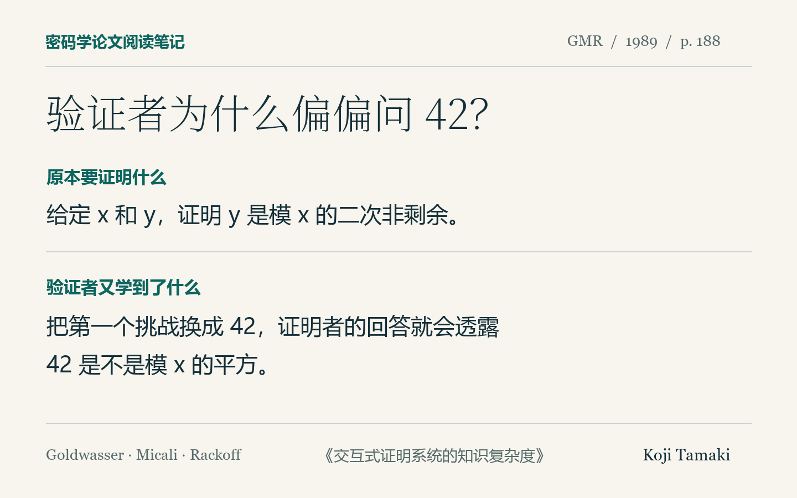

# 《交互式证明系统的知识复杂度》简体中文版

**[下载完整中文版 PDF](https://raw.githubusercontent.com/mavis-codee/gmr1989-zero-knowledge-notes/main/GMR1989.zh-CN.pdf)** · [在线阅读 Markdown 全文](GMR1989.zh-CN.md)

本译稿对应 Shafi Goldwasser、Silvio Micali 和 Charles Rackoff 的论文 *The Knowledge Complexity of Interactive Proof Systems*，依据 1989 年期刊版翻译并经 AI 辅助校对。译文中标有原刊页码（186–208），方便中英对读。[英文原论文](https://doi.org/10.1137/0218012)

## 阅读笔记：零知识证明里为什么会出现 42？

我在用 AI 辅助整理 Goldwasser、Micali 和 Rackoff 的论文《交互式证明系统的知识复杂度》时，读到第 188 页停了下来。证明者本来要证明的是关于 $y$ 的命题；验证者只改了第一条消息，就顺便问了一个关于 42 的问题。这篇中文笔记从这个例子出发，记录我怎么理解作者对“零知识”的定义。页码对应 1989 年《SIAM Journal on Computing》期刊版。[原论文](https://doi.org/10.1137/0218012)

### 一条消息多问了什么？

原刊第 187–188 页，证明者想让验证者相信：$y$ 是模 $x$ 的二次非剩余。通俗地说，就是找不到一个整数，它的平方除以 $x$ 的余数恰好是 $y$。

按例 1 的协议，验证者选随机可逆数 $r$，给证明者发 $r^2$ 或 $yr^2$（都按模 $x$ 计算）。证明者回答收到的数是不是平方。由于验证者知道自己选了哪个分支，当 $y$ 确实是非剩余时，他本来就知道正确答案。

现在把第一个数直接换成 42。证明者仍照规则作答。这一位回复就告诉了验证者：是否存在整数 $z$，使 $z^2\equiv42\pmod{x}$？关键在于验证者可以自己选题。若要证明这个协议是零知识，就得说明连这种验证者所看到的内容也能被高效模拟。作者用这个例子解释早期方案为什么**可能**不满足零知识；第 6 节另行构造了一个协议。

### 读到形式化定义时，可以追问什么？

我会问：给模拟器同样的公共输入，以及验证者本来掌握的辅助信息，但没有证明者帮忙，它能生成怎样的交互视图？“视图”包括验证者自己的随机比特和收发的消息。完美零知识要求模拟视图与真实视图同分布；统计零知识和计算零知识分别给出较弱的要求。原刊第 193–195 页把这些条件写成了精确的定义。

另外两处值得拿纸笔验证的细节，是第 195 页的模平方根例子，以及第 204 页两份应答之间的一个撇号。[两则核对笔记](reading-notes.md)

**原论文作者**　Shafi Goldwasser、Silvio Micali、Charles Rackoff

**中文阅读笔记与配图**　Koji Tamaki（AI 辅助整理、校对）
